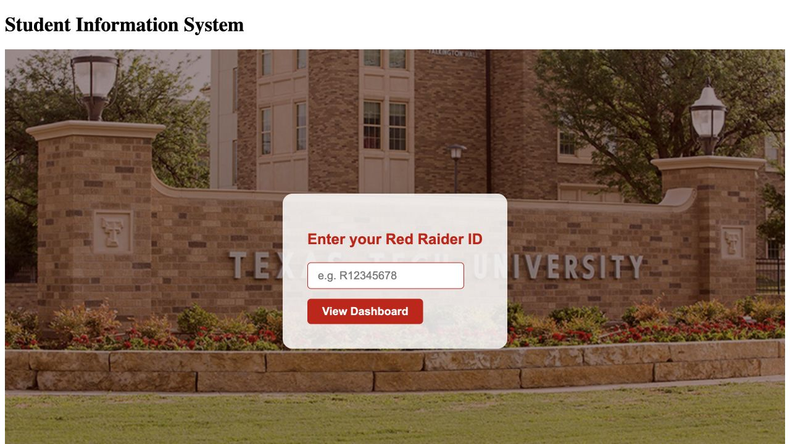

# Texas Tech Student Dashboard

An independent React and TypeScript demo for viewing a synthetic student schedule, exporting a calendar, and finding cited campus resources.

**[Open the live demo →](https://spattoor.github.io/Texastech-Student-Dashboard/)**



## Try it

- Browse two explicitly synthetic classes without signing in or entering a student ID.
- Export **20 scheduled sessions across two weekly sample classes** as one RFC 5545 `.ics` file. Tests verify recurrence, unique event IDs, escaping, and UTF-8 line folding.
- Open campus directions in Google Maps.
- Search a small set of cited Registrar, calendar, and financial-aid resources entirely in the browser.
- Open student details through hash routing; direct links and reloads work.

The public demo uses fictional data. It does not access TTU accounts, grades, enrollment records, or aid eligibility. Campus search is a local keyword reference lookup, not an AI-generated answer. No API keys or paid services are needed.

## Run and verify

```bash
git clone https://github.com/spattoor/Texastech-Student-Dashboard.git
cd Texastech-Student-Dashboard/student-info-website
npm ci --ignore-scripts
npm start
```

```bash
node --test student-info-website/deploy-tests/calendar.test.mjs
cd student-info-website
PUBLIC_URL=. GENERATE_SOURCEMAP=false npm run build
```

GitHub Pages serves the checked-in build under `docs/` on `main`. Rebuild and copy the generated `build/` contents to `docs/` when changing the interface. The app uses relative assets and hash routing for repository-subpath hosting.

The sample schedule runs November 2–December 4, 2026 in CST. It is demonstration data, not actual enrollment. Official reference pages: [Registrar](https://www.depts.ttu.edu/registrar/) and [Financial Aid](https://www.depts.ttu.edu/financialaid/).
